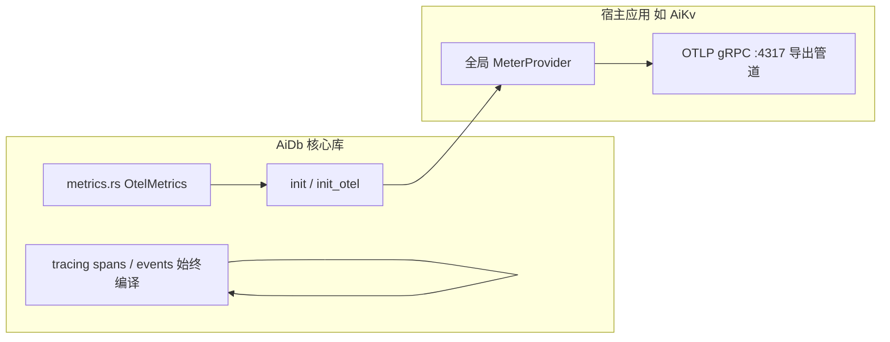

# AiDb Observability (可观测性)

## 何时读本文

- 改 `src/metrics.rs`、`src/cluster/metrics.rs` 或排查 `aidb_*` OTel 监控指标
- 在 **嵌入方** (如 AiKv) 初始化全局 `MeterProvider` 并调用 `metrics::init()`
- 查阅 tracing span / event 命名与索引, 跨模块定位埋点
- **不覆盖**: 各模块内部 span 局部逻辑 → [engine.md](01-engine.md) / [engine-storage.md](02-engine-storage.md) / [cluster.md](03-cluster.md) / [backup.md](04-backup.md)
- **不覆盖**: HTTP `/health` 健康检查端点、OTel Collector 收集器配置 → AiKv 可观测性模块
- **构建**: 需开启 `--features monitoring` 编译 `aidb::metrics`; 默认不启用

## 代码地图

| 路径 | 职责 | 入口 |
| --- | --- | --- |
| `src/metrics.rs` | 引擎 OTel instruments 注册 + `init` / `init_otel` / `record_*` | `DB::open` → `init()` |
| `src/cluster/metrics.rs` | Raft RPC 与集群自愈指标埋点 (需 `cluster` + `monitoring`) | `cluster/network/` (`client.rs` / `server.rs`) |
| `src/lib.rs` | `#[cfg(feature = "monitoring")] pub mod metrics` 声明 | — |
| `tests/common/observability.rs` | `EventCatcher`、tracing 捕获与测试锁 | 跨模块 tracing 验收 |
| `tests/metrics.rs` | cache / bloom / DB histogram 指标导出测试 (InMemory exporter) | `--test metrics` |
| `tests/span_contract.rs` | 只允许 `db_flush`, `cmp_run`, `raft_propose` 的源码扫描 | `--test span_contract` |

**嵌入集成机制**: 下游应用 (AiKv) 设置全局 `MeterProvider` 后调用 `aidb::metrics::init()`; 与上层业务指标共用 OTLP 导出管道, 由 Collector 转发至 Prometheus / Grafana.

## 架构模型: OTel + 宿主嵌入



要点说明:
- **Tracing**: 始终编译 (`tracing` crate); 与 `monitoring` feature 无关.
- **OTel Metrics**: 仅在 `monitoring` feature 下编译; 引擎热路径自动调用 `record_*`.
- **零网络端口**: AiDb 作为库不自建 HTTP / Prometheus listener, 指标统一依托宿主进程导出.

## 生命周期

1. **`DB::open`** (开启 `monitoring`): 内部自动调用 `metrics::init()` (幂等) 并设置初始 sequence gauge.
2. **运行时**: put / get / flush / compaction / backup 等路径自动触发 `record_*` 计数与耗时采集.
3. **宿主启动**: 宿主配置 `MeterProvider` → `aidb::metrics::init()` → OTLP 管道导出.

## Prometheus 指标总表 (`src/metrics.rs`)

| 指标全名 | 类型 | 标签 (Labels) | 触发与采集时机 |
| --- | --- | --- | --- |
| `aidb_wal_size_bytes` | Gauge | — | WAL 追加与轮转清理时刷新 |
| `aidb_memtable_active_bytes` | Gauge | — | 活跃 MemTable |
| `aidb_memtable_frozen_bytes` | Gauge | — | 已冻结 MemTable |
| `aidb_memtable_limit_bytes` | Gauge | — | 启动时的 MemTable 上限 |
| `aidb_l0_files` | Gauge | — | L0 文件数 |
| `aidb_sstable_count` | Gauge | `level` | flush 与 compaction 产生/删除 SST 时更新 |
| `aidb_sstable_size_bytes` | Gauge | `level` | 同上. 未启用 Raft 时没有 `group` |
| `aidb_operations_total` | Counter | `aidb.operation.name` | `put`, `get`, `delete`, `write_batch`, `write_batch_no_wal`, `snapshot`. 不含 stall |
| `aidb_engine_write_duration_seconds` | Histogram | — | 每个用户写批次一次真实耗时, 不重放桶中点 |
| `db.client.operations` | Counter | `db.system`, `db.operation.name` | OpenTelemetry 标准语义双写 |
| `aidb_flush_last_duration_seconds` | Gauge | — | 最近一次 flush 耗时 |
| `aidb_flush_total` | Counter | — | MemTable flush 完成时累加 |
| `aidb_compaction_last_duration_seconds` | Gauge | — | 最近一次 compaction 耗时 |
| `aidb_block_cache_size_bytes` | Gauge | — | 16 分片 LRU 当前缓存占用 |
| `aidb_block_cache_capacity_bytes` | Gauge | — | BlockCache 总容量上限 |
| `aidb_block_cache_hits_total` | Counter | — | BlockCache 读取命中 |
| `aidb_block_cache_misses_total` | Counter | — | BlockCache 读取未命中 |
| `aidb_bloom_false_positive_total` | Counter | — | Bloom Filter 假阳性穿透判定 |
| `aidb_sequence` | Gauge | — | 最新已分配的全局 Sequence 编号 |
| `aidb_compaction_total` | Counter | `aidb.compaction.phase=pick\|run\|apply` | Compaction 各阶段累加 |
| `aidb_write_stall_total` | Counter | `cause`, `kind` | 六种写停顿次数 |
| `aidb_write_stall_window_max_us` | Gauge | — | 本导出周期最大停顿微秒, 读出后清零 |

### 集群指标 (`src/cluster/metrics.rs`, 需 `monitoring` + `cluster`)

| 指标全名 | 类型 | 标签 (Labels) | 触发与采集时机 |
| --- | --- | --- | --- |
| `aidb_raft_apply_lag_entries` | Gauge | `group` | 导出时 `commit - applied`, 不在请求路径计算 |
| `aidb_raft_replication_lag_entries` | Gauge | `group` | leader 上 `last_log - max matched`, 其他角色是 0 |
| `aidb_raft_leader_contact_age_seconds` | Gauge | `group` | follower 距上次心跳的秒数, leader 是 0 |
| `aidb_raft_role` | Gauge | `group`, `role` | 只输出当前角色, 值是 1 |
| `aidb_raft_rpc_total` | Counter | `aidb.raft.rpc.type=vote\|append_entries\|install_snapshot`<br>`aidb.raft.rpc.direction=incoming\|outgoing` | Raft RPC 消息收发计数 |
| `aidb_raft_log_entries_total` | Counter | — | AppendEntries 入站 entry 数量累加 |
| `aidb_raft_group_fatal_total` | Counter | `aidb.raft.group.id` | Group 进入 OpenRaft Fatal 状态时记录 |
| `aidb_raft_group_restart_total` | Counter | `aidb.raft.group.id`<br>`aidb.raft.group.restart.outcome=success\|failure` | 自愈重启 Group 结果统计 |

## Tracing Span 索引

| 模块域 | Span 名 | 主要 Event (`target`) |
| --- | --- | --- |
| **DB 核心** | `db_flush` | `db`: `db.flush.complete` |
| **Compaction** | `cmp_run` | `cmp`: `compaction start`, `compaction end` |
| **Raft propose** | `raft_propose` | `forward retry` |

只允许这三个 span. 采样率为 0 或未配置 OTLP 端点时不创建它们. block 解码, WAL 记录, get, put, backup 和 Raft RPC 没有 span.

### Span 允许名单

- **约束原则**: 除 `db_flush`, `cmp_run`, `raft_propose` 外不得创建 span.
- **契约测试保障**: `tests/span_contract.rs` 扫描源码, 出现 `#[instrument]` 或其他 span 名字时失败:

```bash
cargo test --test span_contract -- --test-threads=1
```

## 常见任务

### 宿主应用绑定 MeterProvider 并导出指标

```rust
// 1. 初始化宿主 OpenTelemetry SDK MeterProvider (示例)
let provider = opentelemetry_sdk::metrics::SdkMeterProvider::builder()
    .with_periodic_exporter(otlp_exporter)
    .build();
opentelemetry::global::set_meter_provider(provider);

// 2. 初始化 AiDb 内部指标
aidb::metrics::init();
```

### 单测中捕获并验证指标

```rust
use aidb::metrics::testutil;

let exporter = testutil::init_in_memory();
// 执行 DB 读写...
let metrics = exporter.get_finished_metrics().unwrap();
```

## 配置与 feature flags

| 项 | 位置 | 说明 |
| --- | --- | --- |
| `monitoring` | `Cargo.toml` | 引入 `opentelemetry`, `opentelemetry_sdk`; 导出 `aidb::metrics` |
| `cluster` + `monitoring` | `Cargo.toml` | 额外激活 `src/cluster/metrics.rs` 中的 Raft RPC 与自愈指标 |

## 测试

```bash
cargo test --test metrics --features monitoring -- --test-threads=1
cargo test --test span_contract -- --test-threads=1
```

| 测试集 | 覆盖 |
| --- | --- |
| `tests/metrics.rs` | BlockCache 命中/未命中 Counter、Bloom 假阳性 Counter、DB 操作与 Flush 耗时 Histogram |
| `tests/span_contract.rs` | 源码扫描契约: 只允许 `db_flush`, `cmp_run`, `raft_propose` |

## 已知限制

- **无内置 HTTP Exporter**: 库不内置 HTTP `/metrics` 端口, 统一由上层应用通过 OTLP 导出.
- **`scan` / `close` 无独立 Counter**: 仅覆盖点查与写批次操作.
- **无进程级系统资源采集**: 内存 RSS、CPU 使用率由宿主环境或 Node Exporter / Alloy 采集.
